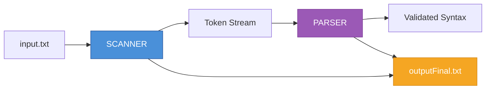
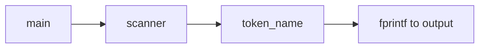
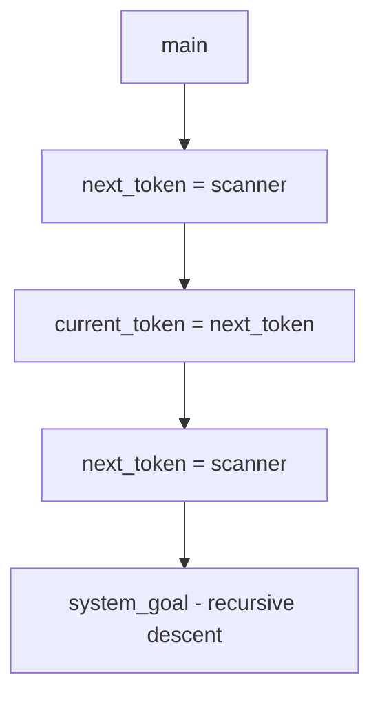
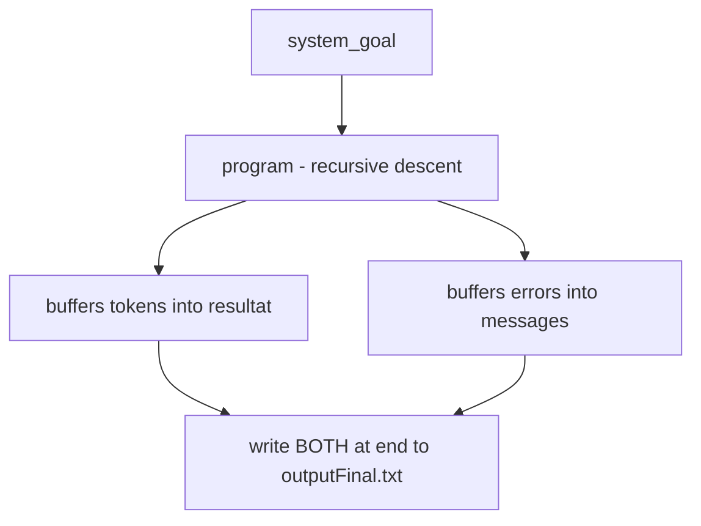
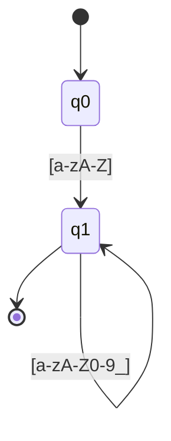

# Micro Language Compiler — Lexical & Syntactic Analyzer

<div align="center">


**A complete compiler front-end for the Micro language**

*From character stream to validated syntax — lexical analysis and syntactic analysis in C*

[Overview](#-overview) •
[Architecture](#-architecture--design) •
[Implementations](#-three-implementations-compared) •
[Building](#-building-the-compiler) •
[Theory](#-academic-background--theory) •
[Extensions](#-suggested-extensions-for-further-research)

</div>

---

## 📋 Table of Contents

<details>
<summary>Click to expand</summary>

- [Overview](#-overview)
- [Repository Structure](#-repository-structure)
- [The Micro Language](#-the-micro-language)
- [Token Specification](#-token-specification)
- [Architecture & Design](#-architecture--design)
- [Three Implementations Compared](#-three-implementations-compared)
- [Detailed Code Walkthrough](#-detailed-code-walkthrough)
- [Building the Compiler](#-building-the-compiler)
- [Running the Analyzers](#-running-the-analyzers)
- [Sample Inputs & Expected Outputs](#-sample-inputs--expected-outputs)
- [Error Handling & Recovery](#-error-handling--recovery)
- [Comparison with Real Compilers](#-comparison-with-real-compilers)
- [Academic Background & Theory](#-academic-background--theory)
- [Limitations & Known Issues](#-limitations--known-issues)
- [Suggested Extensions](#-suggested-extensions-for-further-research)
- [Testing Strategy](#-testing-strategy)
- [License & Acknowledgments](#-license--acknowledgments)
- [Quick Reference Card](#-quick-reference-card)

</details>

---

## 🔍 Overview

This repository contains **three related C programs** that progressively implement the front-end of a compiler for the **Micro** language, spanning two major phases of compilation:

1. **Lexical analysis** (scanner/tokenizer) — converting raw characters into tokens.
2. **Syntactic analysis** (parser) — checking that the token stream conforms to the Micro grammar.

### The Three Implementations

| File | Role | Output |
|------|------|--------|
| 📄 `essay.c` | Scanner only — tokenizes input, writes token names to file | `monoutput.txt` |
| 📄 `version.c` | Scanner + recursive-descent parser (streaming) | `voutput.txt` |
| 📄 `TP2.c` | One-pass scanner + parser, buffered in RAM | `outputFinal.txt` |

> All three share the same **lexical core** (identifiers, integers, keywords, operators, comments) but differ in **how they handle output, buffering, and parsing**.

### Compilation Pipeline



---

## 📁 Repository Structure

```
.
├── 📄 essay.c            # Scanner-only implementation
├── 🔧 essay              # Compiled binary for essay.c
├── 📝 input.txt          # Test input (with deliberate errors)
├── 📤 monoutput.txt      # Output of essay (scanner only)
├── 📤 outputFinal.txt    # Output of TP2 (scanner + parser)
├── 📄 TP2.c              # One-pass scanner + parser (in-memory buffers)
├── 🔧 TP2-1              # Compiled binary for TP2.c
├── 🔧 TP2                # Alternate binary
├── 📄 version.c          # Scanner + parser (streaming, two tokens lookahead)
├── 🔧 version            # Compiled binary for version.c
├── 📤 voutput.txt        # Output of version (empty in current repo)
└── 📦 repomix-output.xml # Packed representation of the repository
```

> **Note:** Binary files (`essay`, `TP2`, `TP2-1`, `version`) are compiled artifacts and are excluded from the packed representation. Only source and text outputs are included.

---

## 🔤 The Micro Language

Micro is a minimal imperative language used in compiler-construction courses, notably inspired by the language in *Compiler Construction: Principles and Practice* by **Kenneth C. Louden**.

### Grammar

```ebnf
program     → "begin" stmt_list "end"
stmt_list   → stmt { ";" stmt }
stmt        → id ":=" expr
            | "read" "(" id_list ")"
            | "write" "(" expr_list ")"
expr        → term { ("+" | "-") term }
term        → factor
factor      → id | int_literal | float_literal | "(" expr ")"
id_list     → id { "," id }
expr_list   → expr { "," expr }
```

### Lexical Conventions

| Element | Pattern | Example |
|---------|---------|---------|
| Keyword | reserved word *(case-insensitive in TP2)* | `begin`, `END` |
| Identifier | `letter (letter \| digit \| _)*` | `x`, `var1`, `_t` |
| Integer | `digit+` | `52`, `0`, `120` |
| Float | `digit+ . digit+ [exponent]` | `13.7`, `5e-2` |
| Assignment | `:=` | `:=` |
| Plus / Minus | `+` / `-` | `+`, `-` |
| Parens | `(` / `)` | `(`, `)` |
| Semicolon | `;` | `;` |
| Comma | `,` | `,` |
| Comment | `--` … end of line | `-- this is ok` |
| Whitespace | space, tab, newline | *(ignored)* |

> ⚠️ **Note:** `essay.c` and `version.c` do **not** support floats; only `TP2.c` does. This is a key difference and a nice pedagogical example of language evolution.

---

## 🏷️ Token Specification

Tokens are defined as an `enum` in C. `essay.c` and `version.c` use a 14-token enum; `TP2.c` extends it with `FLOATLITERAL`:

```c
/* essay.c / version.c */
typedef enum {
    begin, end, read, write,
    id, intliteral,
    lparen, rparen,
    semicolon, comma,
    plusop, minusop,
    assignop, scan_eof
} token;

/* TP2.c adds: */
typedef enum {
    BEGIN, END, READ, WRITE,
    ID, INTLITERAL, LPAREN, RPAREN,
    SEMICOLON, COMMA, ASSIGNOP,
    PLUSOP, MINUSOP, SCANEOF,
    FLOATLITERAL   /* ← new */
} token;
```

Each token has a **type** and, for identifiers/literals, an associated **lexeme** stored in `token_buffer` (essay/version) or `buffer` (TP2).

### Token Display Names (TP2)

```c
char tokens[15][15] = {
    "BEGIN", "END", "READ", "WRITE", "ID", "INTLITERAL",
    "LPAREN", "RPAREN", "SEMICOLON", "COMMA", "ASSIGNOP",
    "PLUSOP", "MINUSOP", "SCANEOF", "FLOATLITERAL"
};
```

---

## 🏗️ Architecture & Design

The three implementations share a common **hand-written scanner** design, but differ in **buffering strategy** and **parser integration**.

### `essay.c` — Scanner Only



- Reads source, writes a flat list of token names to `monoutput.txt`.
- Uses `fgetc`/`ungetc` for one-character lookahead.
- **No parser.**

### `version.c` — Scanner + Parser (Streaming)



- Uses a **two-token lookahead** scheme: `current_token` and `next_token`.
- Parser recurses through `program → inst_list → inst → expr → prim`.
- Does **not** buffer tokens; reads directly from the file.
- On error, skips forward to avoid infinite loops.

### `TP2.c` — One-Pass, In-Memory Buffers



- **One pass** over `input.txt`.
- Token list and error messages are **accumulated in RAM** (`char resultat[MAX_RESULT]`, `char messages[MAX_MSG]`).
- At the end, writes everything to `outputFinal.txt` in two sections:
  1. **Lexical result** — the token stream.
  2. **Syntactic result** — number of errors and detailed messages.

> 💡 This is the most "modern" of the three: it mirrors how real compilers collect diagnostics and emit them at the end, rather than interleaving them with the token stream.

### Flow of Control (TP2 — Most Complete)

```
main()
  └─► system_goal()
        ├─► fopen("input.txt")
        ├─► program()
        │     ├─► next_token() ─► scanner()  (reads file, buffers token)
        │     ├─► match(BEGIN)
        │     ├─► inst_list()
        │     │     └─► inst()  (ID/READ/WRITE dispatch)
        │     │           └─► expression() ─► prim() ─► match(...)
        │     └─► match(END)
        ├─► match(SCANEOF)
        └─► fopen("outputFinal.txt")
              ├─► fprintf(resultat)    // lexical result
              └─► fprintf(messages)    // syntactic result
```

---

## ⚖️ Three Implementations Compared

| Feature | `essay.c` | `version.c` | `TP2.c` |
|---------|:---------:|:-----------:|:-------:|
| **Scanner** | ✅ | ✅ | ✅ |
| **Parser** | ❌ | ✅ | ✅ |
| **Float literals** | ❌ | ❌ | ✅ |
| **Keyword case-insensitivity** | ❌ | ❌ | ✅ |
| **Output style** | Flat token list | *(empty in repo)* | Two-section report |
| **Buffering** | Direct file writes | Direct file writes | In-memory buffers |
| **Lookahead** | 1 char (`ungetc`) | 2 tokens | 1 token + newline marker |
| **Error count limit** | None | ✅ (>50 stops) | ✅ (`nb_erreurs`) |
| **Newline preservation** | ❌ | ❌ | ✅ |
| **`#` handling** | Lexical error | Lexical error | Lexical error |
| **`=` alone** | Lexical error | Lexical error | Lexical error |
| **Comments `--`** | ✅ | ✅ | ✅ |
| **Exponent floats `5e-2`** | ❌ | ❌ | ✅ |
| **`.5` leading-dot floats** | ❌ | ❌ | ✅ |

### Key Takeaway

> 🏆 **`TP2.c`** is the **most feature-complete** and **closest to a real compiler front-end**: it handles floats, is case-insensitive for keywords, buffers diagnostics, and separates lexical from syntactic reporting.
>
> 📘 **`essay.c`** is the minimal scanner.
>
> 🔄 **`version.c`** is an intermediate step that introduces parsing but keeps streaming I/O.

---

## 📖 Detailed Code Walkthrough

### 1. Scanner Core (Shared by All Three)

The scanner uses:

| Technique | Purpose |
|-----------|---------|
| `fgetc(source)` | Character-by-character input |
| `ungetc(c, source)` | One-character lookahead |
| Token buffer | `token_buffer[256]` (essay/version), `buffer[MAX]` (TP2) |
| Line counter | `line_number` or `ligneid` |

#### Identifier Scanning

```c
if (isalpha(in_char)) {
    buffer_char(in_char);
    for (c = fgetc(source); isalnum(c) || c == '_'; c = fgetc(source))
        buffer_char(c);
    ungetc(c, source);
    return check_reserved();
}
```

This implements the DFA:



#### Integer Scanning

```c
else if (isdigit(in_char)) {
    buffer_char(in_char);
    for (c = fgetc(source); isdigit(c); c = fgetc(source))
        buffer_char(c);
    ungetc(c, source);
    return intliteral;
}
```

#### Float Scanning (TP2 Only)

```c
if (isdigit(c)) {
    buffer_char(c);
    c = fgetc(f);
    read_number(f, &c);          // consume digits
    if (c == '.') {              // fractional part
        c = fgetc(f);
        if (isdigit(c)) {
            buffer_char('.');
            read_number(f, &c);
        } else {
            ungetc(c, f);
            return INTLITERAL;
        }
    }
    if (c == 'e' || c == 'E') {  // exponent
        c = fgetc(f);
        exposant(f, &c);
        return FLOATLITERAL;
    }
    if (strchr(buffer, '.') != NULL) return FLOATLITERAL;
    return INTLITERAL;
}
```

Handles:

| Input | Token |
|-------|-------|
| `123` | `INTLITERAL` |
| `13.7` | `FLOATLITERAL` |
| `5e-2` | `FLOATLITERAL` |
| `.5` | `FLOATLITERAL` |

#### Comment Handling

```c
if (c == '-') {
    int c2 = fgetc(f);
    if (c2 == '-') {
        int cc;
        do { cc = fgetc(f); } while (cc != '\n' && cc != EOF);
        ligneid++;
        nouvelle_ligne = 1;
        continue;
    } else {
        ungetc(c2, f);
        return MINUSOP;
    }
}
```

#### Keyword Recognition

```c
token check_reserved() {
    to_maj();                          // uppercase the buffer (TP2 only)
    if (strcmp(buffer, "BEGIN") == 0) return BEGIN;
    if (strcmp(buffer, "END")   == 0) return END;
    if (strcmp(buffer, "READ")  == 0) return READ;
    if (strcmp(buffer, "WRITE") == 0) return WRITE;
    return ID;
}
```

> `essay.c` and `version.c` compare against lowercase only; `TP2.c` uppercases first, making keywords case-insensitive.

### 2. Parser (Recursive Descent)

All parsers are **recursive descent** with one token of lookahead. The grammar is directly transcribed into functions:

| Grammar Rule | Function |
|--------------|----------|
| `<system_goal>` | `system_goal()` |
| `<program>` | `program()` |
| `<inst_list>` | `inst_list()` |
| `<inst>` | `inst()` |
| `<id_list>` | `id_list()` |
| `<expression>` | `expression()` |
| `<expr_list>` | `expr_list()` |
| `<add_op>` | `add_op()` |
| `<prim>` | `prim()` |

#### `match` — The Heart of the Parser

```c
void match(token t) {
    if (courant == t) {
        courant = next_token();
    } else {
        char tmp[100];
        sprintf(tmp, "Trouve %s au lieu de %s\n", tokens[courant], tokens[t]);
        ajouter_message(tmp);
        syntax_error(t);
    }
}
```

- If the current token matches, advance.
- If not, record an error but **do not consume** the offending token — a form of **error recovery** that avoids cascading errors.

#### `prim` — With Error Recovery (TP2)

```c
void prim() {
    if (courant == LPAREN) { match(LPAREN); expression(); match(RPAREN); }
    else if (courant == ID) match(ID);
    else if (courant == INTLITERAL) match(INTLITERAL);
    else if (courant == FLOATLITERAL) match(FLOATLITERAL);
    else if (courant == END || courant == SCANEOF) return;
    else {
        while (courant != RPAREN && courant != COMMA &&
               courant != SEMICOLON && courant != END && courant != SCANEOF) {
            char tmp[100];
            sprintf(tmp, "Trouve %s (inattendu)\n", tokens[courant]);
            ajouter_message(tmp);
            syntax_error(-1);
            courant = next_token();
        }
    }
}
```

> 🎯 This is **panic-mode recovery**: on an unexpected token, skip forward until a **synchronization token** (`)`, `,`, `;`, `end`, EOF) is found. This is exactly the strategy described in the **Dragon Book** (Section 4.1.3).

### 3. Output Buffering (TP2)

```c
char resultat[MAX_RESULT];      // token stream
int  resultat_len = 0;

char messages[MAX_MSG];         // syntax error messages
int  messages_len = 0;

void ajouter_resultat(const char *s) {
    int n = strlen(s);
    if (resultat_len + n < MAX_RESULT - 1) {
        strcpy(resultat + resultat_len, s);
        resultat_len += n;
    }
}
```

Both buffers are appended to with `strcpy` (equivalent to `strcat`, but avoids recomputing `strlen`). At the end of `system_goal()`, both are written to `outputFinal.txt`:

```c
fprintf(final, "===== RESULTAT DE L'ANALYSE LEXICALE =====\n");
fprintf(final, "%s\n", resultat);

fprintf(final, "\n===== RESULTAT DE L'ANALYSE SYNTAXIQUE =====\n");
if (nb_erreurs == 0) {
    fprintf(final, "Aucune erreur detectee. Programme correct.\n");
} else {
    fprintf(final, "Nombre d'erreurs : %d\n", nb_erreurs);
    fprintf(final, "%s", messages);
}
```

> 💡 **Design Note:** This is a **one-pass** design: the file is read once, and all results are collected in RAM. Real compilers often do this to avoid re-reading the source and to produce a complete diagnostic report at the end.

---

## 🔨 Building the Compiler

### Prerequisites

| Requirement | Details |
|-------------|---------|
| **Compiler** | GCC, Clang, or MSVC |
| **Build Tool** | *(Optional)* `make` |
| **Shell** | POSIX-like (Linux, macOS, WSL, Git Bash) |

### Compilation

#### Scanner Only (`essay.c`)

```bash
gcc -Wall -Wextra -O2 -o essay essay.c
```

#### Scanner + Parser (`version.c`)

```bash
gcc -Wall -Wextra -O2 -o version version.c
```

#### One-Pass Compiler (`TP2.c`)

```bash
gcc -Wall -Wextra -O2 -o TP2 TP2.c
```

#### Debug Builds (Recommended for Academic Work)

```bash
gcc -Wall -Wextra -g -fsanitize=address,undefined -o essay_dbg essay.c
gcc -Wall -Wextra -g -fsanitize=address,undefined -o version_dbg version.c
gcc -Wall -Wextra -g -fsanitize=address,undefined -o TP2_dbg TP2.c
```

> ✅ **Highly recommended** for academic work: detects buffer overflows and undefined behavior.

#### Windows (MinGW)

```bash
gcc -Wall -Wextra -O2 -o essay.exe essay.c
gcc -Wall -Wextra -O2 -o version.exe version.c
gcc -Wall -Wextra -O2 -o TP2.exe TP2.c
```

### Optional Makefile

```make
CC      = gcc
CFLAGS  = -Wall -Wextra -O2 -std=c11

all: essay version TP2

essay: essay.c
	$(CC) $(CFLAGS) -o $@ $<

version: version.c
	$(CC) $(CFLAGS) -o $@ $<

TP2: TP2.c
	$(CC) $(CFLAGS) -o $@ $<

debug:
	$(CC) $(CFLAGS) -g -fsanitize=address,undefined -o essay_dbg essay.c
	$(CC) $(CFLAGS) -g -fsanitize=address,undefined -o version_dbg version.c
	$(CC) $(CFLAGS) -g -fsanitize=address,undefined -o TP2_dbg TP2.c

clean:
	rm -f essay version TP2 *_dbg *.exe

.PHONY: all debug clean
```

---

## 🚀 Running the Analyzers

### Scanner Only (`essay`)

```bash
./essay input.txt monoutput.txt
cat monoutput.txt
```

### Scanner + Parser (`version`)

```bash
./version input.txt voutput.txt
cat voutput.txt
```

### One-Pass Compiler (`TP2`)

```bash
./TP2
cat outputFinal.txt
```

> ⚠️ **Note:** `TP2` has **no CLI arguments** — it reads `input.txt` and writes `outputFinal.txt` by convention (hardcoded paths).

### Windows

```cmd
essay.exe input.txt monoutput.txt
version.exe input.txt voutput.txt
TP2.exe
```

---

## 📊 Sample Inputs & Expected Outputs

### Input: `input.txt`

```micro
BEGIN
WRITE (var1 ,(5+13.7), )#;
READ (var1);
V1 = 5e-2 + (120 - 56
WRITE( (hello) , , , );
var :=  ;
READ (a,b, , );
write((1+2)-7,:=,9);
write(++,a+b);
read(a,b;
read(a,,,b)
write(:=,1+2);
var;
var:=6:=9;
END
```

> 🎯 This is a **deliberately error-rich** input designed to test lexical and syntactic error handling.

### Output of `essay` (`monoutput.txt`, Abridged)

```
ID
ID LPAREN ID COMMA LPAREN INTLITERAL PLUSOP INTLITERAL *** ERREUR LEXICALE '.' *** INTLITERAL RPAREN COMMA RPAREN *** ERREUR LEXICALE '#' *** SEMICOLON
ID LPAREN ID RPAREN SEMICOLON
ID *** ERREUR LEXICALE '=' *** INTLITERAL ID MINUSOP INTLITERAL PLUSOP LPAREN INTLITERAL MINUSOP INTLITERAL
...
SCANEOF
```

**Observations:**
- `13.7` is tokenized as `INTLITERAL PLUSOP INTLITERAL` with a `.` lexical error — because `essay.c` does not support floats.
- `=` alone is a lexical error (only `:=` is a valid assignment operator).
- `#` is a lexical error.

### Output of `TP2` (`outputFinal.txt`)

```
===== RESULTAT DE L'ANALYSE LEXICALE =====
BEGIN
WRITE LPAREN ID COMMA LPAREN INTLITERAL PLUSOP INTLITERAL FLOATLITERAL RPAREN COMMA RPAREN SEMICOLON
READ LPAREN ID RPAREN SEMICOLON
ID FLOATLITERAL PLUSOP LPAREN INTLITERAL MINUSOP INTLITERAL
...
END SCANEOF SCANEOF

===== RESULTAT DE L'ANALYSE SYNTAXIQUE =====
Nombre d'erreurs : 28
Trouve FLOATLITERAL au lieu de RPAREN
Erreur de syntaxe ligne 2 : attendu RPAREN
...
```

**Observations:**
- `13.7` is now correctly tokenized as `FLOATLITERAL`.
- `5e-2` is recognized as `FLOATLITERAL`.
- 28 syntactic errors are reported, each with line number and expected token.
- The parser recovers and continues after each error.

### Why the Two Outputs Differ

| Input Fragment | `essay.c` (No Floats) | `TP2.c` (Floats + Case-Insensitive) |
|----------------|----------------------|-------------------------------------|
| `13.7` | `INT(13)` `.`-error `INT(7)` | `FLOATLITERAL` |
| `5e-2` | `INT(5)` `ID(e)` `MINUSOP` `INT(2)` | `FLOATLITERAL` |
| `WRITE` | `ID` (lowercase compare fails) | `WRITE` (uppercased) |
| `write` | `ID` | `WRITE` |

> 💡 This is a **great teaching moment**: lexical rules directly determine what the parser sees, and a small change in the scanner (float support, case-insensitivity) dramatically changes the diagnostic output.

---

## 🛠️ Error Handling & Recovery

### Lexical Errors

- Reported with line number and offending character.
- The scanner **continues** after the error (does not `exit`).
- In `TP2`, lexical errors are appended to `messages[]` and counted in `nb_erreurs`.

### Syntactic Errors

Three strategies are visible across the three implementations:

#### 1. `version.c` — Skip on Mismatch

```c
void match(token expected) {
    if (current_token == expected) {
        current_token = next_token;
        next_token = scanner();
    } else {
        printf("Erreur syntaxique ...");
        error_count++;
        if (error_count > 50) exit(1);
        current_token = next_token;
        next_token = scanner();
    }
}
```

- Simple but can **cascade**: a single missing token produces many errors.
- Caps errors at 50 to avoid infinite loops.

#### 2. `TP2.c` — Panic-Mode Recovery

```c
while (courant != RPAREN && courant != COMMA &&
       courant != SEMICOLON && courant != END && courant != SCANEOF) {
    ...
    courant = next_token();
}
```

- Skips tokens until a **synchronization point** (`)`, `,`, `;`, `end`, EOF).
- This is the classic **panic-mode** strategy from the Dragon Book.

#### 3. `TP2.c` — No Consumption on Mismatch

`match()` records the error but does **not** consume the offending token. This avoids skipping valid tokens and reduces cascading errors.

### Comparison with Real Compilers

| Strategy | This Project | GCC / Clang | javac |
|----------|--------------|-------------|-------|
| Lexical error | Print + continue | Print + continue | Print + continue |
| Syntactic error | Panic-mode (TP2) | Panic-mode + recovery sets | Panic-mode + recovery |
| Error limit | 50 (version) | Configurable | Configurable |
| Error messages | Line number | Line + column + caret | Line + column + caret |
| Multiple errors | ✅ | ✅ | ✅ |
| Error severity | Single level | Warning/Error/Fatal | Warning/Error/Fatal |

---

## ⚖️ Comparison with Real Compilers

| Aspect | This Project | GCC / Clang / MSVC | javac |
|--------|--------------|-------------------|-------|
| **Lexer** | Hand-written | Hand-written (GCC), table-driven (Clang) | Hand-written (Unicode-aware) |
| **Parser** | Recursive descent | Hand-written + generated (Bison for GCC) | Recursive descent |
| **Lookahead** | 1 char + 1 token | 1–2 tokens, sometimes arbitrary | Arbitrary via `Reader` |
| **Keyword lookup** | Linear `strcmp` | Perfect hash / trie | Hash table |
| **Buffer management** | Fixed (256 / MAX) | Growable, memory-mapped | Growable |
| **Float support** | ✅ (TP2 only) | ✅ Full (hex, suffixes, NaN, Inf) | ✅ Full (hex, suffixes, underscores) |
| **Unicode** | ❌ ASCII only | ✅ UTF-8/UTF-16/UTF-32 | ✅ Full Unicode |
| **Error recovery** | Panic-mode | Panic-mode + recovery sets | Panic-mode + recovery |
| **Diagnostics** | Line only | Line + column + file + caret | Line + column + file + caret |
| **AST** | ❌ (no tree built) | ✅ Full AST | ✅ Full AST |
| **Symbol table** | ❌ | ✅ | ✅ |
| **Type checking** | ❌ | ✅ | ✅ |
| **IR / codegen** | ❌ | ✅ | ✅ (bytecode) |
| **Optimization** | ❌ | ✅ (hundreds of passes) | ✅ (JIT + AOT) |
| **Performance** | ~µs per token | ~ns per token (SIMD) | ~ns per token |
| **Testing** | Manual | Massive suites, fuzzing | Massive suites, JCK |
| **Standard** | Ad-hoc | ISO C / ISO C++ | JLS |

### Deeper Comparisons

#### 1. Recursive Descent vs. Generated Parsers

| Compiler | Parser Style |
|----------|-------------|
| **This project** | Recursive descent — each grammar rule becomes a function |
| **GCC** | Bison-generated LALR parser (with hand-written lexer) |
| **Clang** | Hand-written recursive-descent parser with backtracking |
| **javac** | Recursive descent with `TreeMaker` building an AST |

Recursive descent is preferred in modern compilers because:
- It is easy to debug and extend.
- It handles context-sensitive constructs (e.g., C++ `>>`) naturally.
- Error messages can be much better than generated parsers.

> ✅ This project aligns with **modern practice** by using recursive descent.

#### 2. One-Pass vs. Multi-Pass

| Program | Passes |
|---------|--------|
| `TP2.c` | **One-pass**: scanner and parser interleaved |
| `essay.c` | **Scanner-only** (zero passes of parsing) |
| Real compilers | **Multi-pass**: lexing, parsing, semantic analysis, IR, optimization, codegen |

> Even "one-pass" compilers like early Pascal compilers (Turbo Pascal) used the one-pass model, but modern compilers separate phases for modularity.

#### 3. Float Literal Recognition

| Form | This Project (TP2) | GCC / Clang | javac |
|------|:------------------:|:-----------:|:-----:|
| `13.7` | ✅ | ✅ | ✅ |
| `.5` | ✅ | ✅ | ✅ |
| `5e-2` | ✅ | ✅ | ✅ |
| `0x1.8p3` | ❌ | ✅ (hex float) | ✅ (hex float) |
| `1_000_000` | ❌ | ❌ (C23 adds it) | ✅ (underscores) |
| `1.0f` | ❌ | ✅ (suffix) | ✅ (`f`/`d` suffix) |
| `NaN`, `Inf` | ❌ | ✅ | ✅ |

#### 4. Keyword Case Sensitivity

| Program | Case Sensitivity |
|---------|------------------|
| `TP2.c` | **Case-insensitive** (`BEGIN`, `begin`, `Begin` all work) |
| `essay.c` / `version.c` | **Case-sensitive** (lowercase only) |
| **Pascal** | Case-insensitive |
| **C, C++, Java, Python** | Case-sensitive |

> Real compilers make this an explicit language-design choice, not an implementation detail.

---

## 📚 Academic Background & Theory

### Compiler Phases

A compiler is traditionally divided into:

1. **Lexical analysis** — characters → tokens
2. **Syntax analysis** — tokens → parse tree / AST
3. **Semantic analysis** — type checking, scope resolution
4. **Intermediate code generation** — AST → IR
5. **Optimization** — IR → IR
6. **Code generation** — IR → machine code

> This project covers **phases 1 and 2**.

### Formal Languages

| Level | Language Class | Recognizer |
|-------|---------------|------------|
| Lexical structure | **Regular language** | DFA |
| Syntactic structure | **Context-free language** | PDA / recursive descent |

### Regular Expressions for Micro Tokens

| Token | Regular Expression |
|-------|-------------------|
| `BEGIN` | `[bB][eE][gG][iI][nN]` |
| `ID` | `[a-zA-Z][a-zA-Z0-9_]*` |
| `INTLITERAL` | `[0-9]+` |
| `FLOATLITERAL` | `[0-9]+(\.[0-9]+)?([eE][+-]?[0-9]+)?` |
| `ASSIGNOP` | `:=` |
| comment | `--[^\n]*` |

The grammar is **LL(1)** — parseable with one token of lookahead using recursive descent.

### The Maximal Munch Rule

The scanner follows **maximal munch**: it consumes as many characters as possible while matching a token.

| Input | Tokenization | Reason |
|-------|--------------|--------|
| `:=` | `ASSIGNOP` | Preferred over `:` then `=` |
| `13.7` | `FLOATLITERAL` | Not `INT(13)` `.` `INT(7)` |
| `5e-2` | `FLOATLITERAL` | Not `INT(5)` `ID(e)` `MINUSOP` `INT(2)` |

### Panic-Mode Error Recovery

From the Dragon Book (Section 4.1.3):

> **Panic-mode recovery**: On discovering an error, the parser discards input tokens until one of a designated set of **synchronization tokens** is found.

> 🎯 `TP2.c` implements exactly this: it skips tokens until `)`, `,`, `;`, `end`, or EOF.

### References

1. Aho, A. V., Lam, M. S., Sethi, R., & Ullman, J. D. (2006). *Compilers: Principles, Techniques, and Tools* (2nd ed.). Pearson. — **The Dragon Book**.
2. Louden, K. C. (1997). *Compiler Construction: Principles and Practice*. PWS Publishing. — Origin of the Micro language.
3. Levine, J. R. (2009). *Flex & Bison*. O'Reilly Media.
4. Parr, T. (2013). *The Definitive ANTLR 4 Reference*. Pragmatic Bookshelf.
5. GCC source: `libcpp/lex.c`, `gcc/cp/parser.c`.
6. Clang source: `clang/lib/Lex/Lexer.cpp`, `clang/lib/Parse/ParseExpr.cpp`.
7. OpenJDK source: `src/jdk.compiler/share/classes/com/sun/tools/javac/parser/`.

---

## ⚠️ Limitations & Known Issues

| # | Issue | Fix |
|---|-------|-----|
| 1 | **No AST construction** — neither parser builds an AST | Add AST node types, build in `prim`/`expression`/`inst` |
| 2 | **No symbol table** — identifiers not recorded | Add a hash table for identifiers |
| 3 | **No type checking** — `var := (1+2)-7` accepted regardless of types | Add a semantic analyzer |
| 4 | **Fixed-size buffers** — `resultat[MAX_RESULT]` / `messages[MAX_MSG]` can overflow silently | Use dynamic buffers |
| 5 | **O(n²) buffer append** in essay/version — `buffer_char` calls `strlen` per character | Keep an index |
| 6 | **Only one char of `ungetc` guaranteed** by C standard | Respect the constraint (already done) |
| 7 | **No column tracking** — only `line_number` / `ligneid` | Track column too |
| 8 | **Global state** — all programs use globals | Encapsulate in `struct Scanner` / `struct Parser` |
| 9 | **`TP2.c` hardcoded paths** — `input.txt` / `outputFinal.txt` | Accept CLI arguments |
| 10 | **No handling of `*`, `/`, `=`, `<`, `>`** | Extend grammar and scanner |
| 11 | **`essay.c` / `version.c` do not support floats** | Backport the float logic from TP2 |
| 12 | **`essay.c` / `version.c` are case-sensitive for keywords** | Add `to_maj()` as in TP2 |

---

## 🔬 Suggested Extensions for Further Research

### 1. Build an AST

```c
typedef struct Node {
    enum { NODE_ID, NODE_INT, NODE_FLOAT, NODE_BINOP, NODE_ASSIGN,
           NODE_READ, NODE_WRITE } kind;
    union {
        char *name;
        int ival;
        double fval;
        struct { struct Node *left, *right; char op; } binop;
        ...
    } u;
} Node;
```

Build it in `prim`, `expression`, `inst`. Then write a pretty-printer.

### 2. Add a Symbol Table

Hash table mapping identifier names to types and scopes. Detect:
- Undeclared variables
- Redeclared variables
- Unused variables

### 3. Add Type Checking

Extend Micro with `int` and `float` types. Implement a type checker that:
- Promotes `int` to `float` in mixed expressions
- Rejects `float := int` if narrowing is disallowed
- Reports type errors with line numbers

### 4. Generate Intermediate Code

Emit three-address code (TAC):

```
t1 = 5 + 13.7
t2 = t1
var1 = t2
```

Then write an interpreter for the TAC.

### 5. Add a Lexer Generator

Implement a small **Lex**-like tool:
- Input: regular expressions
- Output: a DFA transition table
- Compare performance with the hand-written scanner

### 6. Benchmark Against Real Compilers

Profile with `perf` or `valgrind --tool=callgrind`. Compare tokens/sec with GCC on a large C file.

### 7. Fuzz Testing

Use **AFL** or **libFuzzer** to fuzz the scanner/parser. Find crashes and buffer overflows.

### 8. Formal Verification

Model the parser in **Coq** or **TLA+**. Prove:
- Every accepted input is in the language
- The parser always terminates

### 9. Better Error Recovery

Implement **phrase-level recovery** and **error productions**. Compare with the strategies in the Dragon Book.

### 10. Parallel Scanning

Split the input into chunks and scan concurrently. Reassemble tokens at boundaries.

### 11. Incremental Parsing

Re-parse only the changed region of a file — useful for IDEs.

### 12. Emit Diagnostics in JSON

Modern IDEs (VS Code, Eclipse) consume structured diagnostics. Emit JSON instead of plain text.

---

## 🧪 Testing Strategy

### Unit Tests

Create `.micro` files, each testing one feature:

| File | Tests |
|------|-------|
| `test_keywords.micro` | `begin`, `end`, `read`, `write` |
| `test_ids.micro` | Identifiers with `_` and digits |
| `test_ints.micro` | Integers, leading zeros |
| `test_floats.micro` | `13.7`, `.5`, `5e-2`, `1.5E+3` |
| `test_ops.micro` | `:=`, `+`, `-` |
| `test_punct.micro` | `(`, `)`, `;`, `,` |
| `test_comments.micro` | `--` comments |
| `test_errors.micro` | Illegal characters |
| `test_empty.micro` | Empty file |
| `test_eof.micro` | File without trailing newline |

### Golden Tests

Store expected outputs and diff:

```bash
./essay test_keywords.micro out.txt
diff out.txt expected/test_keywords.out
```

### Sanitizer Tests

```bash
make debug
for f in tests/*.micro; do ./essay_dbg "$f" /dev/null; done
for f in tests/*.micro; do ./version_dbg "$f" /dev/null; done
```

### Fuzzing

```bash
afl-gcc -o essay_afl essay.c
afl-fuzz -i seeds/ -o findings/ ./essay_afl @@ /dev/null
```

### Continuous Integration

Add `.github/workflows/ci.yml` to build and test on Linux, macOS, and Windows.

---

## 📜 License & Acknowledgments

This project is an educational implementation of a compiler front-end for the **Micro** language, inspired by:

- Kenneth C. Louden, *Compiler Construction: Principles and Practice*.
- Aho, Lam, Sethi, Ullman, *Compilers: Principles, Techniques, and Tools*.

It is intended for **academic use**. Feel free to fork, extend, and use it in courses on compiler construction.

### Suggested Citation

```bibtex
@misc{micro_compiler,
  title  = {Micro Language Compiler — Lexical and Syntactic Analyzer},
  author = {Anonymous},
  year   = {2024},
  note   = {Educational compiler front-end in C},
  url    = {https://github.com/example/micro-compiler}
}
```

---

## 🗂️ Quick Reference Card

### Build Commands

```bash
# Build all
gcc -Wall -Wextra -O2 -o essay essay.c
gcc -Wall -Wextra -O2 -o version version.c
gcc -Wall -Wextra -O2 -o TP2 TP2.c

# Run scanner only
./essay input.txt monoutput.txt

# Run scanner + parser (streaming)
./version input.txt voutput.txt

# Run one-pass compiler (hardcoded paths)
./TP2
cat outputFinal.txt

# Debug builds
gcc -g -fsanitize=address,undefined -o essay_dbg essay.c
gcc -g -fsanitize=address,undefined -o version_dbg version.c
gcc -g -fsanitize=address,undefined -o TP2_dbg TP2.c
```

### Token Reference

| Token | Display Name | Example |
|-------|--------------|---------|
| Keyword | `BEGIN` etc. | `begin`, `END` |
| Identifier | `ID` | `x`, `var1` |
| Integer | `INTLITERAL` | `52`, `0` |
| Float | `FLOATLITERAL` | `13.7`, `5e-2` |
| Assignment | `ASSIGNOP` | `:=` |
| Plus / Minus | `PLUSOP` / `MINUSOP` | `+`, `-` |
| Parens | `LPAREN` / `RPAREN` | `(`, `)` |
| Semicolon | `SEMICOLON` | `;` |
| Comma | `COMMA` | `,` |
| EOF | `SCANEOF` | — |

### Common Issues

| Issue | Solution |
|-------|----------|
| `WRITE` not recognized | Add `to_maj()` for case-insensitivity |
| `13.7` split into two tokens | Enable float support in scanner |
| Buffer overflow | Increase `MAX_RESULT` / `MAX_MSG` or bounds-check |
| Cascading syntax errors | Implement panic-mode recovery |

---

<div align="center">

**⭐ Star this repository if you find it useful! ⭐**

*Made with ❤️ for compiler construction education*

[Back to Top](#micro-language-compiler--lexical--syntactic-analyzer)

</div>
