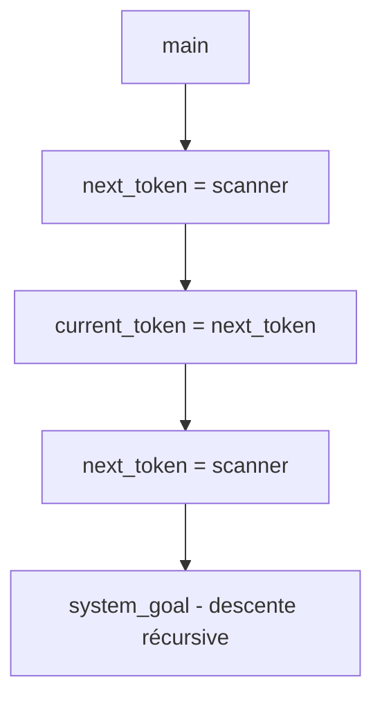
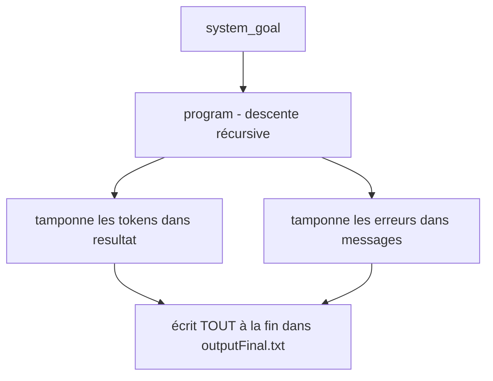
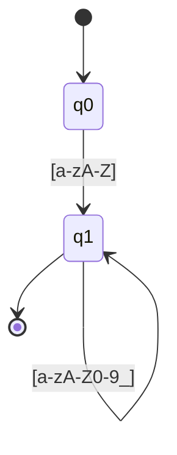

# Compilateur du Langage Micro — Analyseur Lexical et Syntaxique

<div align="center">


**Un front-end complet de compilateur pour le langage Micro**

*Du flux de caractères à la syntaxe validée — analyse lexicale et analyse syntaxique en C*

[Aperçu](#-aperçu) •
[Architecture](#-architecture--conception) •
[Implémentations](#-trois-implémentations-comparées) •
[Compilation](#-compilation-du-compilateur) •
[Théorie](#-contexte-académique--théorie) •
[Extensions](#-extensions-suggérées-pour-la-recherche)

</div>

---

## 📋 Table des Matières

<details>
<summary>Cliquez pour développer</summary>

- [Aperçu](#-aperçu)
- [Structure du Dépôt](#-structure-du-dépôt)
- [Le Langage Micro](#-le-langage-micro)
- [Spécification des Tokens](#-spécification-des-tokens)
- [Architecture & Conception](#-architecture--conception)
- [Trois Implémentations Comparées](#-trois-implémentations-comparées)
- [Analyse Détaillée du Code](#-analyse-détaillée-du-code)
- [Compilation du Compilateur](#-compilation-du-compilateur)
- [Exécution des Analyseurs](#-exécution-des-analyseurs)
- [Exemples d'Entrées & Sorties Attendues](#-exemples-dentrées--sorties-attendues)
- [Gestion et Récupération des Erreurs](#-gestion-et-récupération-des-erreurs)
- [Comparaison avec les Compilateurs Réels](#-comparaison-avec-les-compilateurs-réels)
- [Contexte Académique & Théorie](#-contexte-académique--théorie)
- [Limitations & Problèmes Connus](#-limitations--problèmes-connus)
- [Extensions Suggérées](#-extensions-suggérées-pour-la-recherche)
- [Stratégie de Test](#-stratégie-de-test)
- [Licence & Remerciements](#-licence--remerciements)
- [Carte de Référence Rapide](#-carte-de-référence-rapide)

</details>

---

## 🔍 Aperçu

Ce dépôt contient **trois programmes C apparentés** qui implémentent progressivement le front-end d'un compilateur pour le langage **Micro**, couvrant deux phases majeures de la compilation :

1. **Analyse lexicale** (scanner/tokenizer) — conversion des caractères bruts en tokens.
2. **Analyse syntaxique** (parser) — vérification que le flux de tokens est conforme à la grammaire Micro.

### Les Trois Implémentations

| Fichier | Rôle | Sortie |
|---------|------|--------|
| 📄 `essay.c` | Scanner uniquement — tokenise l'entrée, écrit les noms de tokens dans un fichier | `monoutput.txt` |
| 📄 `version.c` | Scanner + parseur à descente récursive (streaming) | `voutput.txt` |
| 📄 `TP2.c` | Scanner + parseur en une passe, tamponné en RAM | `outputFinal.txt` |

> Les trois partagent le même **cœur lexical** (identificateurs, entiers, mots-clés, opérateurs, commentaires) mais diffèrent dans **la gestion de la sortie, du buffering et du parsing**.

### Pipeline de Compilation


---

## 📁 Structure du Dépôt

```
.
├── 📄 essay.c            # Implémentation scanner uniquement
├── 🔧 essay              # Binaire compilé pour essay.c
├── 📝 input.txt          # Entrée de test (avec erreurs délibérées)
├── 📤 monoutput.txt      # Sortie de essay (scanner uniquement)
├── 📤 outputFinal.txt    # Sortie de TP2 (scanner + parseur)
├── 📄 TP2.c              # Scanner + parseur en une passe (tampons en mémoire)
├── 🔧 TP2-1              # Binaire compilé pour TP2.c
├── 🔧 TP2                # Binaire alternatif
├── 📄 version.c          # Scanner + parseur (streaming, deux tokens de lookahead)
├── 🔧 version            # Binaire compilé pour version.c
├── 📤 voutput.txt        # Sortie de version (vide dans le dépôt actuel)
└── 📦 repomix-output.xml # Représentation packagée du dépôt
```

> **Remarque :** Les fichiers binaires (`essay`, `TP2`, `TP2-1`, `version`) sont des artefacts compilés et sont exclus de la représentation packagée. Seuls les sources et les sorties texte sont inclus.

---

## 🔤 Le Langage Micro

Micro est un langage impératif minimal utilisé dans les cours de construction de compilateurs, notamment inspiré du langage de *Compiler Construction: Principles and Practice* de **Kenneth C. Louden**.

### Grammaire

```ebnf
program     → "begin" stmt_list "end"
stmt_list   → stmt { ";" stmt }
stmt        → id ":=" expr
            | "read" "(" id_list ")"
            | "write" "(" expr_list ")"
expr        → term { ("+" | "-") term }
term        → factor
factor      → id | int_literal | float_literal | "(" expr ")"
id_list     → id { "," id }
expr_list   → expr { "," expr }
```

### Conventions Lexicales

| Élément | Motif | Exemple |
|---------|-------|---------|
| Mot-clé | mot réservé *(insensible à la casse dans TP2)* | `begin`, `END` |
| Identificateur | `lettre (lettre \| chiffre \| _)*` | `x`, `var1`, `_t` |
| Entier | `chiffre+` | `52`, `0`, `120` |
| Flottant | `chiffre+ . chiffre+ [exposant]` | `13.7`, `5e-2` |
| Affectation | `:=` | `:=` |
| Plus / Moins | `+` / `-` | `+`, `-` |
| Parenthèses | `(` / `)` | `(`, `)` |
| Point-virgule | `;` | `;` |
| Virgule | `,` | `,` |
| Commentaire | `--` … fin de ligne | `-- ceci est ok` |
| Espace blanc | espace, tabulation, saut de ligne | *(ignoré)* |

> ⚠️ **Remarque :** `essay.c` et `version.c` ne supportent **pas** les flottants ; seul `TP2.c` le fait. C'est une différence clé et un bon exemple pédagogique d'évolution du langage.

---

## 🏷️ Spécification des Tokens

Les tokens sont définis comme un `enum` en C. `essay.c` et `version.c` utilisent un enum de 14 tokens ; `TP2.c` l'étend avec `FLOATLITERAL` :

```c
/* essay.c / version.c */
typedef enum {
    begin, end, read, write,
    id, intliteral,
    lparen, rparen,
    semicolon, comma,
    plusop, minusop,
    assignop, scan_eof
} token;

/* TP2.c ajoute : */
typedef enum {
    BEGIN, END, READ, WRITE,
    ID, INTLITERAL, LPAREN, RPAREN,
    SEMICOLON, COMMA, ASSIGNOP,
    PLUSOP, MINUSOP, SCANEOF,
    FLOATLITERAL   /* ← nouveau */
} token;
```

Chaque token a un **type** et, pour les identificateurs/littéraux, un **lexème** associé stocké dans `token_buffer` (essay/version) ou `buffer` (TP2).

### Noms d'Affichage des Tokens (TP2)

```c
char tokens[15][15] = {
    "BEGIN", "END", "READ", "WRITE", "ID", "INTLITERAL",
    "LPAREN", "RPAREN", "SEMICOLON", "COMMA", "ASSIGNOP",
    "PLUSOP", "MINUSOP", "SCANEOF", "FLOATLITERAL"
};
```

---

## 🏗️ Architecture & Conception

Les trois implémentations partagent une conception commune de **scanner écrit à la main**, mais diffèrent dans la **stratégie de buffering** et l'**intégration du parseur**.

### `essay.c` — Scanner Uniquement


- Lit la source, écrit une liste plate de noms de tokens dans `monoutput.txt`.
- Utilise `fgetc`/`ungetc` pour un lookahead d'un caractère.
- **Pas de parseur.**

### `version.c` — Scanner + Parseur (Streaming)



- Utilise un **lookahead de deux tokens** : `current_token` et `next_token`.
- Le parseur récurse à travers `program → inst_list → inst → expr → prim`.
- Ne **tamponne pas** les tokens ; lit directement depuis le fichier.
- En cas d'erreur, avance pour éviter les boucles infinies.

### `TP2.c` — Une Passe, Tampons en Mémoire



- **Une seule passe** sur `input.txt`.
- La liste des tokens et les messages d'erreur sont **accumulés en RAM** (`char resultat[MAX_RESULT]`, `char messages[MAX_MSG]`).
- À la fin, écrit tout dans `outputFinal.txt` en deux sections :
  1. **Résultat lexical** — le flux de tokens.
  2. **Résultat syntaxique** — nombre d'erreurs et messages détaillés.

> 💡 C'est le plus « moderne » des trois : il reflète la façon dont les compilateurs réels collectent les diagnostics et les émettent à la fin, plutôt que de les entrelacer avec le flux de tokens.

### Flux de Contrôle (TP2 — Le Plus Complet)

```
main()
  └─► system_goal()
        ├─► fopen("input.txt")
        ├─► program()
        │     ├─► next_token() ─► scanner()  (lit le fichier, tamponne le token)
        │     ├─► match(BEGIN)
        │     ├─► inst_list()
        │     │     └─► inst()  (dispatch ID/READ/WRITE)
        │     │           └─► expression() ─► prim() ─► match(...)
        │     └─► match(END)
        ├─► match(SCANEOF)
        └─► fopen("outputFinal.txt")
              ├─► fprintf(resultat)    // résultat lexical
              └─► fprintf(messages)    // résultat syntaxique
```

---

## ⚖️ Trois Implémentations Comparées

| Fonctionnalité | `essay.c` | `version.c` | `TP2.c` |
|----------------|:---------:|:-----------:|:-------:|
| **Scanner** | ✅ | ✅ | ✅ |
| **Parseur** | ❌ | ✅ | ✅ |
| **Littéraux flottants** | ❌ | ❌ | ✅ |
| **Insensibilité à la casse des mots-clés** | ❌ | ❌ | ✅ |
| **Style de sortie** | Liste plate de tokens | *(vide dans le dépôt)* | Rapport en deux sections |
| **Buffering** | Écritures directes dans le fichier | Écritures directes dans le fichier | Tampons en mémoire |
| **Lookahead** | 1 caractère (`ungetc`) | 2 tokens | 1 token + marqueur de nouvelle ligne |
| **Limite d'erreurs** | Aucune | ✅ (>50 arrête) | ✅ (`nb_erreurs`) |
| **Préservation des nouvelles lignes** | ❌ | ❌ | ✅ |
| **Gestion de `#`** | Erreur lexicale | Erreur lexicale | Erreur lexicale |
| **`=` seul** | Erreur lexicale | Erreur lexicale | Erreur lexicale |
| **Commentaires `--`** | ✅ | ✅ | ✅ |
| **Flottants avec exposant `5e-2`** | ❌ | ❌ | ✅ |
| **Flottants à point initial `.5`** | ❌ | ❌ | ✅ |

### Point Clé

> 🏆 **`TP2.c`** est le plus **complet** et le plus **proche d'un vrai front-end de compilateur** : il gère les flottants, est insensible à la casse pour les mots-clés, tamponne les diagnostics et sépare le reporting lexical du syntaxique.
>
> 📘 **`essay.c`** est le scanner minimal.
>
> 🔄 **`version.c`** est une étape intermédiaire qui introduit le parsing mais conserve l'I/O en streaming.

---

## 📖 Analyse Détaillée du Code

### 1. Cœur du Scanner (Partagé par les Trois)

Le scanner utilise :

| Technique | Objectif |
|-----------|----------|
| `fgetc(source)` | Entrée caractère par caractère |
| `ungetc(c, source)` | Lookahead d'un caractère |
| Tampon de token | `token_buffer[256]` (essay/version), `buffer[MAX]` (TP2) |
| Compteur de ligne | `line_number` ou `ligneid` |

#### Analyse des Identificateurs

```c
if (isalpha(in_char)) {
    buffer_char(in_char);
    for (c = fgetc(source); isalnum(c) || c == '_'; c = fgetc(source))
        buffer_char(c);
    ungetc(c, source);
    return check_reserved();
}
```

Ceci implémente le DFA :



#### Analyse des Entiers

```c
else if (isdigit(in_char)) {
    buffer_char(in_char);
    for (c = fgetc(source); isdigit(c); c = fgetc(source))
        buffer_char(c);
    ungetc(c, source);
    return intliteral;
}
```

#### Analyse des Flottants (TP2 Uniquement)

```c
if (isdigit(c)) {
    buffer_char(c);
    c = fgetc(f);
    read_number(f, &c);          // consomme les chiffres
    if (c == '.') {              // partie fractionnaire
        c = fgetc(f);
        if (isdigit(c)) {
            buffer_char('.');
            read_number(f, &c);
        } else {
            ungetc(c, f);
            return INTLITERAL;
        }
    }
    if (c == 'e' || c == 'E') {  // exposant
        c = fgetc(f);
        exposant(f, &c);
        return FLOATLITERAL;
    }
    if (strchr(buffer, '.') != NULL) return FLOATLITERAL;
    return INTLITERAL;
}
```

Gère :

| Entrée | Token |
|--------|-------|
| `123` | `INTLITERAL` |
| `13.7` | `FLOATLITERAL` |
| `5e-2` | `FLOATLITERAL` |
| `.5` | `FLOATLITERAL` |

#### Gestion des Commentaires

```c
if (c == '-') {
    int c2 = fgetc(f);
    if (c2 == '-') {
        int cc;
        do { cc = fgetc(f); } while (cc != '\n' && cc != EOF);
        ligneid++;
        nouvelle_ligne = 1;
        continue;
    } else {
        ungetc(c2, f);
        return MINUSOP;
    }
}
```

#### Reconnaissance des Mots-Clés

```c
token check_reserved() {
    to_maj();                          // met le tampon en majuscules (TP2 uniquement)
    if (strcmp(buffer, "BEGIN") == 0) return BEGIN;
    if (strcmp(buffer, "END")   == 0) return END;
    if (strcmp(buffer, "READ")  == 0) return READ;
    if (strcmp(buffer, "WRITE") == 0) return WRITE;
    return ID;
}
```

> `essay.c` et `version.c` comparent uniquement en minuscules ; `TP2.c` met d'abord en majuscules, rendant les mots-clés insensibles à la casse.

### 2. Parseur (Descente Récursive)

Tous les parseurs sont à **descente récursive** avec un token de lookahead. La grammaire est directement transcrite en fonctions :

| Règle de Grammaire | Fonction |
|--------------------|----------|
| `<system_goal>` | `system_goal()` |
| `<program>` | `program()` |
| `<inst_list>` | `inst_list()` |
| `<inst>` | `inst()` |
| `<id_list>` | `id_list()` |
| `<expression>` | `expression()` |
| `<expr_list>` | `expr_list()` |
| `<add_op>` | `add_op()` |
| `<prim>` | `prim()` |

#### `match` — Le Cœur du Parseur

```c
void match(token t) {
    if (courant == t) {
        courant = next_token();
    } else {
        char tmp[100];
        sprintf(tmp, "Trouve %s au lieu de %s\n", tokens[courant], tokens[t]);
        ajouter_message(tmp);
        syntax_error(t);
    }
}
```

- Si le token courant correspond, on avance.
- Sinon, on enregistre une erreur mais on **ne consomme pas** le token fautif — une forme de **récupération d'erreur** qui évite les erreurs en cascade.

#### `prim` — Avec Récupération d'Erreur (TP2)

```c
void prim() {
    if (courant == LPAREN) { match(LPAREN); expression(); match(RPAREN); }
    else if (courant == ID) match(ID);
    else if (courant == INTLITERAL) match(INTLITERAL);
    else if (courant == FLOATLITERAL) match(FLOATLITERAL);
    else if (courant == END || courant == SCANEOF) return;
    else {
        while (courant != RPAREN && courant != COMMA &&
               courant != SEMICOLON && courant != END && courant != SCANEOF) {
            char tmp[100];
            sprintf(tmp, "Trouve %s (inattendu)\n", tokens[courant]);
            ajouter_message(tmp);
            syntax_error(-1);
            courant = next_token();
        }
    }
}
```

> 🎯 C'est la **récupération en mode panique** : en cas de token inattendu, on saute vers l'avant jusqu'à un **token de synchronisation** (`)`, `,`, `;`, `end`, EOF). C'est exactement la stratégie décrite dans le **Dragon Book** (Section 4.1.3).

### 3. Tampon de Sortie (TP2)

```c
char resultat[MAX_RESULT];      // flux de tokens
int  resultat_len = 0;

char messages[MAX_MSG];         // messages d'erreur syntaxique
int  messages_len = 0;

void ajouter_resultat(const char *s) {
    int n = strlen(s);
    if (resultat_len + n < MAX_RESULT - 1) {
        strcpy(resultat + resultat_len, s);
        resultat_len += n;
    }
}
```

Les deux tampons sont complétés avec `strcpy` (équivalent à `strcat`, mais évite de recalculer `strlen`). À la fin de `system_goal()`, les deux sont écrits dans `outputFinal.txt` :

```c
fprintf(final, "===== RESULTAT DE L'ANALYSE LEXICALE =====\n");
fprintf(final, "%s\n", resultat);

fprintf(final, "\n===== RESULTAT DE L'ANALYSE SYNTAXIQUE =====\n");
if (nb_erreurs == 0) {
    fprintf(final, "Aucune erreur detectee. Programme correct.\n");
} else {
    fprintf(final, "Nombre d'erreurs : %d\n", nb_erreurs);
    fprintf(final, "%s", messages);
}
```

> 💡 **Note de Conception :** C'est une conception **en une passe** : le fichier est lu une fois, et tous les résultats sont collectés en RAM. Les compilateurs réels font souvent cela pour éviter de relire la source et pour produire un rapport de diagnostic complet à la fin.

---

## 🔨 Compilation du Compilateur

### Prérequis

| Exigence | Détails |
|----------|---------|
| **Compilateur** | GCC, Clang ou MSVC |
| **Outil de build** | *(Optionnel)* `make` |
| **Shell** | POSIX-like (Linux, macOS, WSL, Git Bash) |

### Compilation

#### Scanner Uniquement (`essay.c`)

```bash
gcc -Wall -Wextra -O2 -o essay essay.c
```

#### Scanner + Parseur (`version.c`)

```bash
gcc -Wall -Wextra -O2 -o version version.c
```

#### Compilateur en Une Passe (`TP2.c`)

```bash
gcc -Wall -Wextra -O2 -o TP2 TP2.c
```

#### Builds de Débogage (Recommandés pour le Travail Académique)

```bash
gcc -Wall -Wextra -g -fsanitize=address,undefined -o essay_dbg essay.c
gcc -Wall -Wextra -g -fsanitize=address,undefined -o version_dbg version.c
gcc -Wall -Wextra -g -fsanitize=address,undefined -o TP2_dbg TP2.c
```

> ✅ **Fortement recommandé** pour le travail académique : détecte les débordements de tampon et les comportements indéfinis.

#### Windows (MinGW)

```bash
gcc -Wall -Wextra -O2 -o essay.exe essay.c
gcc -Wall -Wextra -O2 -o version.exe version.c
gcc -Wall -Wextra -O2 -o TP2.exe TP2.c
```

### Makefile Optionnel

```make
CC      = gcc
CFLAGS  = -Wall -Wextra -O2 -std=c11

all: essay version TP2

essay: essay.c
	$(CC) $(CFLAGS) -o $@ $<

version: version.c
	$(CC) $(CFLAGS) -o $@ $<

TP2: TP2.c
	$(CC) $(CFLAGS) -o $@ $<

debug:
	$(CC) $(CFLAGS) -g -fsanitize=address,undefined -o essay_dbg essay.c
	$(CC) $(CFLAGS) -g -fsanitize=address,undefined -o version_dbg version.c
	$(CC) $(CFLAGS) -g -fsanitize=address,undefined -o TP2_dbg TP2.c

clean:
	rm -f essay version TP2 *_dbg *.exe

.PHONY: all debug clean
```

---

## 🚀 Exécution des Analyseurs

### Scanner Uniquement (`essay`)

```bash
./essay input.txt monoutput.txt
cat monoutput.txt
```

### Scanner + Parseur (`version`)

```bash
./version input.txt voutput.txt
cat voutput.txt
```

### Compilateur en Une Passe (`TP2`)

```bash
./TP2
cat outputFinal.txt
```

> ⚠️ **Remarque :** `TP2` n'a **pas d'arguments CLI** — il lit `input.txt` et écrit `outputFinal.txt` par convention (chemins codés en dur).

### Windows

```cmd
essay.exe input.txt monoutput.txt
version.exe input.txt voutput.txt
TP2.exe
```

---

## 📊 Exemples d'Entrées & Sorties Attendues

### Entrée : `input.txt`

```micro
BEGIN
WRITE (var1 ,(5+13.7), )#;
READ (var1);
V1 = 5e-2 + (120 - 56
WRITE( (hello) , , , );
var :=  ;
READ (a,b, , );
write((1+2)-7,:=,9);
write(++,a+b);
read(a,b;
read(a,,,b)
write(:=,1+2);
var;
var:=6:=9;
END
```

> 🎯 C'est une entrée **délibérément riche en erreurs**, conçue pour tester la gestion des erreurs lexicales et syntaxiques.

### Sortie de `essay` (`monoutput.txt`, Abrégée)

```
ID
ID LPAREN ID COMMA LPAREN INTLITERAL PLUSOP INTLITERAL *** ERREUR LEXICALE '.' *** INTLITERAL RPAREN COMMA RPAREN *** ERREUR LEXICALE '#' *** SEMICOLON
ID LPAREN ID RPAREN SEMICOLON
ID *** ERREUR LEXICALE '=' *** INTLITERAL ID MINUSOP INTLITERAL PLUSOP LPAREN INTLITERAL MINUSOP INTLITERAL
...
SCANEOF
```

**Observations :**
- `13.7` est tokenisé comme `INTLITERAL PLUSOP INTLITERAL` avec une erreur lexicale `.` — car `essay.c` ne supporte pas les flottants.
- `=` seul est une erreur lexicale (seul `:=` est un opérateur d'affectation valide).
- `#` est une erreur lexicale.

### Sortie de `TP2` (`outputFinal.txt`)

```
===== RESULTAT DE L'ANALYSE LEXICALE =====
BEGIN
WRITE LPAREN ID COMMA LPAREN INTLITERAL PLUSOP INTLITERAL FLOATLITERAL RPAREN COMMA RPAREN SEMICOLON
READ LPAREN ID RPAREN SEMICOLON
ID FLOATLITERAL PLUSOP LPAREN INTLITERAL MINUSOP INTLITERAL
...
END SCANEOF SCANEOF

===== RESULTAT DE L'ANALYSE SYNTAXIQUE =====
Nombre d'erreurs : 28
Trouve FLOATLITERAL au lieu de RPAREN
Erreur de syntaxe ligne 2 : attendu RPAREN
...
```

**Observations :**
- `13.7` est maintenant correctement tokenisé comme `FLOATLITERAL`.
- `5e-2` est reconnu comme `FLOATLITERAL`.
- 28 erreurs syntaxiques sont signalées, chacune avec le numéro de ligne et le token attendu.
- Le parseur se rétablit et continue après chaque erreur.

### Pourquoi les Deux Sorties Diffèrent

| Fragment d'Entrée | `essay.c` (Sans Flottants) | `TP2.c` (Flottants + Insensible à la Casse) |
|-------------------|----------------------------|---------------------------------------------|
| `13.7` | `INT(13)` erreur `.` `INT(7)` | `FLOATLITERAL` |
| `5e-2` | `INT(5)` `ID(e)` `MINUSOP` `INT(2)` | `FLOATLITERAL` |
| `WRITE` | `ID` (comparaison minuscule échoue) | `WRITE` (mis en majuscules) |
| `write` | `ID` | `WRITE` |

> 💡 C'est un **excellent moment pédagogique** : les règles lexicales déterminent directement ce que voit le parseur, et un petit changement dans le scanner (support des flottants, insensibilité à la casse) change radicalement la sortie de diagnostic.

---

## 🛠️ Gestion et Récupération des Erreurs

### Erreurs Lexicales

- Signalées avec le numéro de ligne et le caractère fautif.
- Le scanner **continue** après l'erreur (ne fait pas `exit`).
- Dans `TP2`, les erreurs lexicales sont ajoutées à `messages[]` et comptées dans `nb_erreurs`.

### Erreurs Syntaxiques

Trois stratégies sont visibles à travers les trois implémentations :

#### 1. `version.c` — Saut en Cas de Non-Correspondance

```c
void match(token expected) {
    if (current_token == expected) {
        current_token = next_token;
        next_token = scanner();
    } else {
        printf("Erreur syntaxique ...");
        error_count++;
        if (error_count > 50) exit(1);
        current_token = next_token;
        next_token = scanner();
    }
}
```

- Simple mais peut **cascader** : un seul token manquant produit de nombreuses erreurs.
- Limite les erreurs à 50 pour éviter les boucles infinies.

#### 2. `TP2.c` — Récupération en Mode Panique

```c
while (courant != RPAREN && courant != COMMA &&
       courant != SEMICOLON && courant != END && courant != SCANEOF) {
    ...
    courant = next_token();
}
```

- Saute des tokens jusqu'à un **point de synchronisation** (`)`, `,`, `;`, `end`, EOF).
- C'est la stratégie classique du **mode panique** du Dragon Book.

#### 3. `TP2.c` — Pas de Consommation en Cas de Non-Correspondance

`match()` enregistre l'erreur mais ne **consomme pas** le token fautif. Cela évite de sauter des tokens valides et réduit les erreurs en cascade.

### Comparaison avec les Compilateurs Réels

| Stratégie | Ce Projet | GCC / Clang | javac |
|-----------|-----------|-------------|-------|
| Erreur lexicale | Affiche + continue | Affiche + continue | Affiche + continue |
| Erreur syntaxique | Mode panique (TP2) | Mode panique + ensembles de récupération | Mode panique + récupération |
| Limite d'erreurs | 50 (version) | Configurable | Configurable |
| Messages d'erreur | Numéro de ligne | Ligne + colonne + caret | Ligne + colonne + caret |
| Erreurs multiples | ✅ | ✅ | ✅ |
| Sévérité d'erreur | Niveau unique | Warning/Error/Fatal | Warning/Error/Fatal |

---

## ⚖️ Comparaison avec les Compilateurs Réels

| Aspect | Ce Projet | GCC / Clang / MSVC | javac |
|--------|-----------|-------------------|-------|
| **Lexer** | Écrit à la main | Écrit à la main (GCC), piloté par table (Clang) | Écrit à la main (Unicode-aware) |
| **Parseur** | Descente récursive | Écrit à la main + généré (Bison pour GCC) | Descente récursive |
| **Lookahead** | 1 caractère + 1 token | 1–2 tokens, parfois arbitraire | Arbitraire via `Reader` |
| **Recherche de mots-clés** | `strcmp` linéaire | Hash parfait / trie | Table de hachage |
| **Gestion de tampon** | Fixe (256 / MAX) | Extensible, mappé en mémoire | Extensible |
| **Support des flottants** | ✅ (TP2 uniquement) | ✅ Complet (hex, suffixes, NaN, Inf) | ✅ Complet (hex, suffixes, underscores) |
| **Unicode** | ❌ ASCII uniquement | ✅ UTF-8/UTF-16/UTF-32 | ✅ Unicode complet |
| **Récupération d'erreur** | Mode panique | Mode panique + ensembles de récupération | Mode panique + récupération |
| **Diagnostics** | Ligne uniquement | Ligne + colonne + fichier + caret | Ligne + colonne + fichier + caret |
| **AST** | ❌ (aucun arbre construit) | ✅ AST complet | ✅ AST complet |
| **Table des symboles** | ❌ | ✅ | ✅ |
| **Vérification de type** | ❌ | ✅ | ✅ |
| **IR / codegen** | ❌ | ✅ | ✅ (bytecode) |
| **Optimisation** | ❌ | ✅ (centaines de passes) | ✅ (JIT + AOT) |
| **Performance** | ~µs par token | ~ns par token (SIMD) | ~ns par token |
| **Tests** | Manuels | Suites massives, fuzzing | Suites massives, JCK |
| **Standard** | Ad-hoc | ISO C / ISO C++ | JLS |

### Comparaisons Approfondies

#### 1. Descente Récursive vs. Parseurs Générés

| Compilateur | Style de Parseur |
|-------------|-----------------|
| **Ce projet** | Descente récursive — chaque règle de grammaire devient une fonction |
| **GCC** | Parseur LALR généré par Bison (avec lexer écrit à la main) |
| **Clang** | Parseur à descente récursive écrit à la main avec backtracking |
| **javac** | Descente récursive avec `TreeMaker` construisant un AST |

La descente récursive est préférée dans les compilateurs modernes car :
- Elle est facile à déboguer et à étendre.
- Elle gère naturellement les constructions sensibles au contexte (ex. `>>` en C++).
- Les messages d'erreur peuvent être bien meilleurs que ceux des parseurs générés.

> ✅ Ce projet s'aligne sur la **pratique moderne** en utilisant la descente récursive.

#### 2. Une Passe vs. Multi-Passes

| Programme | Passes |
|-----------|--------|
| `TP2.c` | **Une passe** : scanner et parseur entrelacés |
| `essay.c` | **Scanner uniquement** (zéro passe de parsing) |
| Compilateurs réels | **Multi-passes** : lexing, parsing, analyse sémantique, IR, optimisation, codegen |

> Même les compilateurs « en une passe » comme les premiers compilateurs Pascal (Turbo Pascal) utilisaient le modèle en une passe, mais les compilateurs modernes séparent les phases pour la modularité.

#### 3. Reconnaissance des Littéraux Flottants

| Forme | Ce Projet (TP2) | GCC / Clang | javac |
|-------|:---------------:|:-----------:|:-----:|
| `13.7` | ✅ | ✅ | ✅ |
| `.5` | ✅ | ✅ | ✅ |
| `5e-2` | ✅ | ✅ | ✅ |
| `0x1.8p3` | ❌ | ✅ (flottant hex) | ✅ (flottant hex) |
| `1_000_000` | ❌ | ❌ (C23 l'ajoute) | ✅ (underscores) |
| `1.0f` | ❌ | ✅ (suffixe) | ✅ (suffixe `f`/`d`) |
| `NaN`, `Inf` | ❌ | ✅ | ✅ |

#### 4. Sensibilité à la Casse des Mots-Clés

| Programme | Sensibilité à la Casse |
|-----------|------------------------|
| `TP2.c` | **Insensible** (`BEGIN`, `begin`, `Begin` fonctionnent) |
| `essay.c` / `version.c` | **Sensible** (minuscules uniquement) |
| **Pascal** | Insensible à la casse |
| **C, C++, Java, Python** | Sensible à la casse |

> Les compilateurs réels font de ceci un choix explicite de conception du langage, pas un détail d'implémentation.

---

## 📚 Contexte Académique & Théorie

### Phases du Compilateur

Un compilateur est traditionnellement divisé en :

1. **Analyse lexicale** — caractères → tokens
2. **Analyse syntaxique** — tokens → arbre de parsing / AST
3. **Analyse sémantique** — vérification de type, résolution de portée
4. **Génération de code intermédiaire** — AST → IR
5. **Optimisation** — IR → IR
6. **Génération de code** — IR → code machine

> Ce projet couvre les **phases 1 et 2**.

### Langages Formels

| Niveau | Classe de Langage | Reconnaisseur |
|--------|-------------------|---------------|
| Structure lexicale | **Langage régulier** | DFA |
| Structure syntaxique | **Langage hors-contexte** | PDA / descente récursive |

### Expressions Régulières pour les Tokens Micro

| Token | Expression Régulière |
|-------|---------------------|
| `BEGIN` | `[bB][eE][gG][iI][nN]` |
| `ID` | `[a-zA-Z][a-zA-Z0-9_]*` |
| `INTLITERAL` | `[0-9]+` |
| `FLOATLITERAL` | `[0-9]+(\.[0-9]+)?([eE][+-]?[0-9]+)?` |
| `ASSIGNOP` | `:=` |
| commentaire | `--[^\n]*` |

La grammaire est **LL(1)** — analysable avec un token de lookahead en descente récursive.

### La Règle du Plus Long Match

Le scanner suit le **plus long match** (maximal munch) : il consomme autant de caractères que possible tout en correspondant à un token.

| Entrée | Tokenisation | Raison |
|--------|--------------|--------|
| `:=` | `ASSIGNOP` | Préféré à `:` puis `=` |
| `13.7` | `FLOATLITERAL` | Pas `INT(13)` `.` `INT(7)` |
| `5e-2` | `FLOATLITERAL` | Pas `INT(5)` `ID(e)` `MINUSOP` `INT(2)` |

### Récupération en Mode Panique

Du Dragon Book (Section 4.1.3) :

> **Récupération en mode panique** : en découvrant une erreur, le parseur rejette les tokens d'entrée jusqu'à ce que l'un d'un ensemble désigné de **tokens de synchronisation** soit trouvé.

> 🎯 `TP2.c` implémente exactement ceci : il saute des tokens jusqu'à `)`, `,`, `;`, `end`, ou EOF.

### Références

1. Aho, A. V., Lam, M. S., Sethi, R., & Ullman, J. D. (2006). *Compilers: Principles, Techniques, and Tools* (2nd ed.). Pearson. — **Le Dragon Book**.
2. Louden, K. C. (1997). *Compiler Construction: Principles and Practice*. PWS Publishing. — Origine du langage Micro.
3. Levine, J. R. (2009). *Flex & Bison*. O'Reilly Media.
4. Parr, T. (2013). *The Definitive ANTLR 4 Reference*. Pragmatic Bookshelf.
5. Source GCC : `libcpp/lex.c`, `gcc/cp/parser.c`.
6. Source Clang : `clang/lib/Lex/Lexer.cpp`, `clang/lib/Parse/ParseExpr.cpp`.
7. Source OpenJDK : `src/jdk.compiler/share/classes/com/sun/tools/javac/parser/`.

---

## ⚠️ Limitations & Problèmes Connus

| # | Problème | Correction |
|---|----------|------------|
| 1 | **Pas de construction d'AST** — aucun parseur ne construit d'AST | Ajouter des types de nœuds AST, construire dans `prim`/`expression`/`inst` |
| 2 | **Pas de table des symboles** — les identificateurs ne sont pas enregistrés | Ajouter une table de hachage pour les identificateurs |
| 3 | **Pas de vérification de type** — `var := (1+2)-7` accepté indépendamment des types | Ajouter un analyseur sémantique |
| 4 | **Tampons de taille fixe** — `resultat[MAX_RESULT]` / `messages[MAX_MSG]` peuvent déborder silencieusement | Utiliser des tampons dynamiques |
| 5 | **Ajout O(n²) au tampon** dans essay/version — `buffer_char` appelle `strlen` par caractère | Garder un index |
| 6 | **Un seul caractère de `ungetc` garanti** par le standard C | Respecter la contrainte (déjà fait) |
| 7 | **Pas de suivi de colonne** — seulement `line_number` / `ligneid` | Suivre aussi la colonne |
| 8 | **État global** — tous les programmes utilisent des globales | Encapsuler dans `struct Scanner` / `struct Parser` |
| 9 | **Chemins codés en dur de `TP2.c`** — `input.txt` / `outputFinal.txt` | Accepter des arguments CLI |
| 10 | **Pas de gestion de `*`, `/`, `=`, `<`, `>`** | Étendre la grammaire et le scanner |
| 11 | **`essay.c` / `version.c` ne supportent pas les flottants** | Porter la logique des flottants depuis TP2 |
| 12 | **`essay.c` / `version.c` sont sensibles à la casse pour les mots-clés** | Ajouter `to_maj()` comme dans TP2 |

---

## 🔬 Extensions Suggérées pour la Recherche

### 1. Construire un AST

```c
typedef struct Node {
    enum { NODE_ID, NODE_INT, NODE_FLOAT, NODE_BINOP, NODE_ASSIGN,
           NODE_READ, NODE_WRITE } kind;
    union {
        char *name;
        int ival;
        double fval;
        struct { struct Node *left, *right; char op; } binop;
        ...
    } u;
} Node;
```

Construisez-le dans `prim`, `expression`, `inst`. Puis écrivez un pretty-printer.

### 2. Ajouter une Table des Symboles

Table de hachage associant les noms d'identificateurs aux types et portées. Détecter :
- Variables non déclarées
- Variables redéclarées
- Variables inutilisées

### 3. Ajouter la Vérification de Type

Étendre Micro avec les types `int` et `float`. Implémenter un vérificateur de type qui :
- Promeut `int` en `float` dans les expressions mixtes
- Rejette `float := int` si le rétrécissement est interdit
- Signale les erreurs de type avec les numéros de ligne

### 4. Générer du Code Intermédiaire

Émettre du code à trois adresses (TAC) :

```
t1 = 5 + 13.7
t2 = t1
var1 = t2
```

Puis écrire un interpréteur pour le TAC.

### 5. Ajouter un Générateur de Lexer

Implémenter un petit outil **type Lex** :
- Entrée : expressions régulières
- Sortie : table de transition DFA
- Comparer les performances avec le scanner écrit à la main

### 6. Comparer avec les Compilateurs Réels

Profiler avec `perf` ou `valgrind --tool=callgrind`. Comparer tokens/sec avec GCC sur un grand fichier C.

### 7. Tests par Fuzzing

Utiliser **AFL** ou **libFuzzer** pour fuzzer le scanner/parseur. Trouver des crashes et des débordements de tampon.

### 8. Vérification Formelle

Modéliser le parseur en **Coq** ou **TLA+**. Prouver :
- Chaque entrée acceptée appartient au langage
- Le parseur termine toujours

### 9. Meilleure Récupération d'Erreur

Implémenter la **récupération au niveau phrase** et les **productions d'erreur**. Comparer avec les stratégies du Dragon Book.

### 10. Scan Parallèle

Diviser l'entrée en morceaux et scanner en parallèle. Réassembler les tokens aux frontières.

### 11. Parsing Incrémental

Re-parser uniquement la région modifiée d'un fichier — utile pour les IDE.

### 12. Émettre des Diagnostics en JSON

Les IDE modernes (VS Code, Eclipse) consomment des diagnostics structurés. Émettre du JSON au lieu de texte brut.

---

## 🧪 Stratégie de Test

### Tests Unitaires

Créer des fichiers `.micro`, chacun testant une fonctionnalité :

| Fichier | Tests |
|---------|-------|
| `test_keywords.micro` | `begin`, `end`, `read`, `write` |
| `test_ids.micro` | Identificateurs avec `_` et chiffres |
| `test_ints.micro` | Entiers, zéros en tête |
| `test_floats.micro` | `13.7`, `.5`, `5e-2`, `1.5E+3` |
| `test_ops.micro` | `:=`, `+`, `-` |
| `test_punct.micro` | `(`, `)`, `;`, `,` |
| `test_comments.micro` | Commentaires `--` |
| `test_errors.micro` | Caractères illégaux |
| `test_empty.micro` | Fichier vide |
| `test_eof.micro` | Fichier sans nouvelle ligne finale |

### Tests de Référence (Golden)

Stocker les sorties attendues et comparer :

```bash
./essay test_keywords.micro out.txt
diff out.txt expected/test_keywords.out
```

### Tests avec Sanitizers

```bash
make debug
for f in tests/*.micro; do ./essay_dbg "$f" /dev/null; done
for f in tests/*.micro; do ./version_dbg "$f" /dev/null; done
```

### Fuzzing

```bash
afl-gcc -o essay_afl essay.c
afl-fuzz -i seeds/ -o findings/ ./essay_afl @@ /dev/null
```

### Intégration Continue

Ajouter `.github/workflows/ci.yml` pour compiler et tester sur Linux, macOS et Windows.

---

## 📜 Licence & Remerciements

Ce projet est une implémentation éducative d'un front-end de compilateur pour le langage **Micro**, inspiré par :

- Kenneth C. Louden, *Compiler Construction: Principles and Practice*.
- Aho, Lam, Sethi, Ullman, *Compilers: Principles, Techniques, and Tools*.

Il est destiné à un **usage académique**. N'hésitez pas à forker, étendre et utiliser dans des cours de construction de compilateurs.

### Citation Suggérée

```bibtex
@misc{micro_compiler,
  title  = {Compilateur du Langage Micro — Analyseur Lexical et Syntaxique},
  author = {Anonyme},
  year   = {2024},
  note   = {Front-end de compilateur éducatif en C},
  url    = {https://github.com/example/micro-compiler}
}
```

---

## 🗂️ Carte de Référence Rapide

### Commandes de Compilation

```bash
# Tout compiler
gcc -Wall -Wextra -O2 -o essay essay.c
gcc -Wall -Wextra -O2 -o version version.c
gcc -Wall -Wextra -O2 -o TP2 TP2.c

# Exécuter le scanner uniquement
./essay input.txt monoutput.txt

# Exécuter le scanner + parseur (streaming)
./version input.txt voutput.txt

# Exécuter le compilateur en une passe (chemins codés en dur)
./TP2
cat outputFinal.txt

# Builds de débogage
gcc -g -fsanitize=address,undefined -o essay_dbg essay.c
gcc -g -fsanitize=address,undefined -o version_dbg version.c
gcc -g -fsanitize=address,undefined -o TP2_dbg TP2.c
```

### Référence des Tokens

| Token | Nom d'Affichage | Exemple |
|-------|-----------------|---------|
| Mot-clé | `BEGIN` etc. | `begin`, `END` |
| Identificateur | `ID` | `x`, `var1` |
| Entier | `INTLITERAL` | `52`, `0` |
| Flottant | `FLOATLITERAL` | `13.7`, `5e-2` |
| Affectation | `ASSIGNOP` | `:=` |
| Plus / Moins | `PLUSOP` / `MINUSOP` | `+`, `-` |
| Parenthèses | `LPAREN` / `RPAREN` | `(`, `)` |
| Point-virgule | `SEMICOLON` | `;` |
| Virgule | `COMMA` | `,` |
| EOF | `SCANEOF` | — |

### Problèmes Courants

| Problème | Solution |
|----------|----------|
| `WRITE` non reconnu | Ajouter `to_maj()` pour l'insensibilité à la casse |
| `13.7` divisé en deux tokens | Activer le support des flottants dans le scanner |
| Débordement de tampon | Augmenter `MAX_RESULT` / `MAX_MSG` ou vérifier les bornes |
| Erreurs syntaxiques en cascade | Implémenter la récupération en mode panique |

---

<div align="center">

**⭐ Star ce dépôt si tu le trouves utile ! ⭐**

*Fait avec ❤️ pour l'enseignement de la construction de compilateurs*

[Retour en Haut](#compilateur-du-langage-micro--analyseur-lexical-et-syntaxique)

</div>
